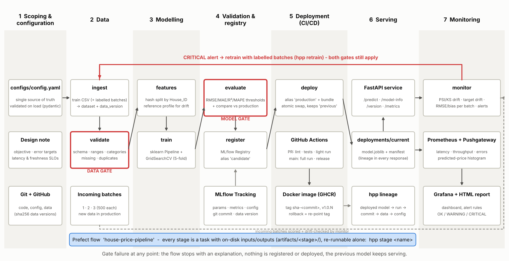

# Design note: house-price pipeline (Project 4, Group 10)

**Omer Raza (B052), Arfeen Khan (B050)**, MSc Data Science, NMIMS. MLOps, Dr. Santosh Kumar.

## 1. Objective

A listings platform needs a price estimate for every new property. We predict `Price_Lakhs` from nine
listing attributes. Everything around the model is automated: data arrives, gets validated, the model is
trained and gated, then registered, deployed, monitored, and retrained when it needs to be. The rule is that
**no person moves a model into production by hand, and a bad model or a bad batch can never replace the one
that is serving.**

## 2. Success metrics and their thresholds

The model gate uses the holdout set (787 rows chosen with a deterministic hash split on `House_ID`).
The figures in the right-hand column come from the deployed model, v1.

| Metric | Gate | Why this number | v1 holdout |
|---|---|---|---|
| RMSE | ≤ 9.0 lakhs | Predicting the mean price gives an RMSE of 22.0. Our 5-fold CV RMSE is 7.55 ± 0.44, so 9.0 sits about 3σ above it and still about 2.4× better than that naive baseline. | **7.81** |
| MAE | ≤ 7.0 lakhs | A typical miss stays under ₹7 lakh, which is about 11% of the mean price of 61.9 lakhs. | **5.84** |
| R² | ≥ 0.80 | The model has to explain at least 80% of the variation in price. | **0.875** |
| MAPE | ≤ 15% | Keeps the error under control for cheap homes too, where an absolute RMSE says little. | **9.7%** |
| vs production | RMSE ≤ +2% | Both models are scored on the same holdout rows, so the comparison is paired. A 2% margin (about 0.16 lakh) absorbs refit noise. Anything worse than that is a real regression. | n/a (first model) |

**Plain-language reading:** an RMSE of 7.8 means a typical estimate is about **±₹8 lakh** off a
₹62-lakh home (roughly ±13%). For 58% of holdout homes the estimate is within 10% of the real price.

**Data gate (per source).** Every incoming source must pass these checks on its own. Mixing a bad batch
into 4,000 clean rows would otherwise dilute its problems below the thresholds.
- Required columns are present and numeric columns are numeric.
- At least 200 rows. Fewer than that cannot support a meaningful retrain.
- Missing values at most **10%** per column. The raw data has 4.0% missing (160 of 4,000) in three columns,
  so this leaves 2.5× headroom. The derived bad batch has 37.8% missing and fails.
- Invalid rows at most **1%**. A row is invalid if a value falls outside its domain range (for example area
  100 to 10,000 sqft, bedrooms 1 to 10) or uses an unknown category.
- **0** duplicate IDs and **0** missing targets.

**Non-functional requirements.**
- API p95 latency **< 300 ms**. One prediction takes about 5 ms in the model and about 16 ms p95 when
  scored row by row.
- Error rate **< 1%**.
- Every run is reproducible from a fresh clone: holdout RMSE and MAE must match `reports/reference_metrics.json`
  within ±0.05 lakhs.
- Every deployed model traces back to a commit, a data hash, a config hash and an MLflow run.

**Freshness and retraining policy.** Each labelled batch is monitored as it arrives.
- A **WARNING** (RMSE at least 1.15× the holdout RMSE, any feature with PSI ≥ 0.10, or bias of at least 5%
  of the mean price) schedules a retrain that includes the batch.
- A **CRITICAL** (RMSE at least 1.30×, PSI ≥ 0.20, 30% or more of features drifted, or bias of at least 10%)
  triggers `hpp retrain --batches …` straight away.
- The new model still has to pass both gates. Production is never replaced automatically on a monitoring
  signal (`auto_retrain: false`).
- PSI cut-offs of 0.10 and 0.20 are the usual credit-risk convention. A KS or χ² p-value below 0.01 is
  reported alongside PSI as statistical confirmation.

## 3. Architecture

**Layout.**
- One YAML file (`configs/config.yaml`) drives the whole system. It is validated with strict pydantic models,
  and its canonical hash is logged with every run.
- Eight stages run as a Prefect 3 flow. A local engine runs the same functions in the same order.
- Each stage reads and writes declared artifacts under `artifacts/<stage>/`. That lets any stage be re-run
  alone, and a stage refuses to run when its upstream output is missing or stale.
- MLflow stores runs, metrics, artifacts and the registry. Only the pipeline sets the aliases
  `candidate`, `production` and `previous-production`; each transition is tagged `transitioned_by=pipeline`.
- `deploy` builds a self-contained bundle (model plus manifest) and swaps it in atomically
  (`deployments/current` ↔ `previous`).
- The FastAPI image ships the bundle and exposes Prometheus metrics. Grafana shows latency, throughput,
  errors and the predicted-price distribution.
- `monitor` computes data drift and performance drift for each batch, pushes them to Pushgateway, and writes
  an HTML report.
- GitHub Actions runs tests plus a light pipeline on every PR. A merge to `main` re-runs the full pipeline,
  checks reproducibility, builds an image tagged `sha-<commit>`, pushes it to GHCR and creates a release.

## 4. Lifecycle mapping

| Lifecycle step | Where it lives | Gate or evidence |
|---|---|---|
| Data ingestion and versioning | `hpp.data` (`ingest`) | sha256 per source → `data_version` |
| Validation | `hpp.validation` (`validate`) | **Data gate** (exit 2), `artifacts/validate/report.json` |
| Feature engineering | `hpp.features` (`features`) | Reference profile and sample for drift |
| Training and tuning | `hpp.train` (`train`) | MLflow run with lineage tags, CV grid search |
| Evaluation | `hpp.evaluate` (`evaluate`) | **Model gate**: thresholds plus comparison with production (exit 3) |
| Registry | `hpp.registry` (`register`) | Alias `candidate`, refused unless the gate passed in the same run |
| Deployment | `hpp.deploy` (`deploy`), Docker, `release.yml` | Atomic swap, `production` alias, image `sha-<commit>` |
| Monitoring | `hpp.monitor` (`monitor`), Prometheus/Grafana | PSI/KS/χ², RMSE ratio, bias, latency, errors |
| Retraining and rollback | `hpp retrain`, `hpp rollback`, `rollback.yml` | Same gates; rollback restores the previous bundle and aliases |

## 5. Trade-offs we accepted

- **Gradient boosting over a deep model.** The data is small and tabular (4,000 rows). Boosting is accurate
  here, fits in seconds and is easy to explain.
- **A hash split instead of a random split.** A house stays on the same side of the split even when new
  batches are added, so the model gate's comparison with production remains fair.
- **Hand-written PSI, KS and χ² instead of Evidently.** This keeps dependencies light, and the same numbers
  go to Pushgateway. Evidently can be added later as an extra report.
- **A local registry (SQLite) instead of a hosted one.** It keeps a fresh clone self-contained. The cost is
  that each CI run starts with an empty registry. Our improvement is a hosted MLflow server.
