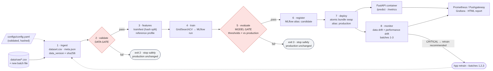
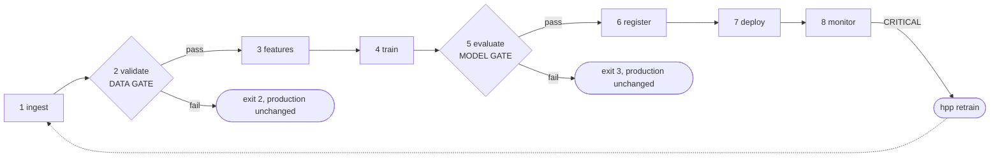

# Workflow graph

The graph matches `hpp.orchestration` (Prefect flow `house-price-pipeline`; the local engine runs the same
order). Source: `docs/diagrams/workflow_graph.mmd` (rendered to `docs/images/workflow_graph.png`).

## Stage contracts

Each stage reads only the declared inputs (from `artifacts/`) and writes only its outputs, so any stage can be
re-run alone (`hpp stage <name>`, `make stage S=<name>`). A stage refuses to start if an input is missing,
naming the upstream stage to run first (exit 5). `features` also refuses data that did not pass the data
gate for the *same* `data_version` (exit 2), and `register` refuses a model whose gate did not pass in the
same training run (exit 3). Declared in `src/hpp/context.py::STAGE_IO`.

| # | Stage | Inputs | Outputs | Fails with |
|---|---|---|---|---|
| 1 | ingest | `data/raw/*.csv`, optional `--batch-file`, `train_with_batches` | `ingest/dataset.csv`, `ingest/meta.json` (sources + sha256, `data_version`) | - |
| 2 | validate | ingest outputs | `validate/report.json` | **DataGateError, exit 2** |
| 3 | features | ingest + validate outputs | `features/train.csv`, `test.csv`, `reference_profile.json`, `reference_sample.csv`, `meta.json` | exit 2 if data not validated |
| 4 | train | `features/train.csv`, `features/meta.json` | `train/model.joblib`, `train/meta.json`, `train/cv_results.csv`, MLflow run | - |
| 5 | evaluate | train outputs, `features/test.csv`, production model | `evaluate/metrics.json`, `evaluate/gate.json`, plots | **ModelGateError, exit 3** |
| 6 | register | `train/meta.json`, `evaluate/gate.json` | `register/registered.json`, registry version + alias `candidate` | exit 3 if gate not passed |
| 7 | deploy | register outputs, model, metrics, reference profile | `deploy/deployed.json`, `deployments/current/` (previous kept in `deployments/previous/`), aliases `production` / `previous-production` | - |
| 8 | monitor | `deployments/current/` | `reports/monitoring/summary.json`, `report.html`, charts, per-batch predictions; Pushgateway metrics | - |

## Run history and stage logs

* `logs/run_history.jsonl`: one line per stage execution (`pipeline_run_id`, stage, status
  `success | gate_failed | failed`, duration, orchestrator, detail). Print with `hpp history`.
* `logs/<pipeline_run_id>/<stage>.log`: the full log of every stage execution.
* With Prefect, the same runs appear in the Prefect UI (`prefect server start`, http://localhost:4200) as
  flow runs with one task run per stage. Screenshot that for the deliverables.

An example history is in `docs/evidence/run_history.txt`.
